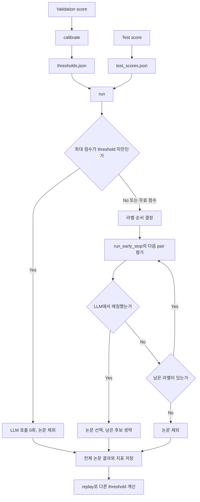

# BioLORD negative pruning 코드와 실험 안내

실험 5는 논문과 표적 이상반응 라벨의 BioLORD 유사도를 계산해, 가능성이 낮은 논문의 LLM 평가를 건너뛴다. 남은 논문은 유사도가 높은 라벨부터 평가하고 첫 매칭에서 종료한다.

| 작업 | 명령 | 생성하는 파일 | LLM 호출 |
|---|---|---|---|
| Validation 점수 계산 | `score --split validation` | `validation_scores.json` | 0회 |
| Threshold 결정 | `calibrate` | `thresholds.json` | 0회 |
| Test 점수 계산 | `score --split test` | `test_scores.json` | 0회 |
| 실험 5 실행 | `run` | 실행 폴더의 설정·진행 기록·결과·요약 | 유지한 논문만 평가 |
| 다른 threshold 계산 | `replay` | 새 threshold의 결과 JSON | 추가 0회 |

Threshold는 **validation의 BioLORD 점수와 BioDEX가 제공하는 정답 라벨**로 정한다. 이 과정의 LLM 호출은 0회다. Validation 보정 파일과 test 점수 파일을 준비하면 **5번을 바로 실행**할 수 있다.

**4번 결과는 5번의 비용·품질을 비교할 대조군**으로 사용한다. 4번은 5번의 전후 어느 시점에 실행해도 된다. 실제 실행 순서는 `validation score → calibrate → test score → 5번 run → 5번 결과로 replay`다. 비교 시 4번과 5번의 모델·입력·점수 정책은 일치시킨다.

## 1. 먼저 이해할 예시

실제 코드는 표적 라벨 10개를 사용한다. 아래는 그중 라벨 3개만 표시한 가상의 점수다.

| 논문 | Liver injury | Hepatitis | Hepatic failure | 최대 점수 |
|---|---:|---:|---:|---:|
| A | 0.70 | 0.60 | 0.30 | 0.70 |
| B | 0.40 | 0.25 | 0.20 | 0.40 |

생략한 7개 라벨의 점수는 A에서 모두 0.30 이하, B에서 모두 0.40 이하라고 가정한다. 따라서 표의 최대 점수가 전체 10개 라벨의 최대 점수다.

Threshold가 0.5이면 A는 유지한다. LLM에 Liver injury를 먼저 묻고, `False`면 Hepatitis를 묻는다. 여기서 `True`가 나오면 A를 결과에 넣고 나머지 후보를 건너뛴다. 전부 `False`이면 결과에서 제외한다.

B는 최대 점수가 0.40이므로 라벨 10개에 대한 LLM 평가를 전부 생략한다. B의 호출 수는 0이고, 최종 선택 결과에도 포함하지 않는다. 최대 점수가 정확히 0.5이면 유지한다.

## 2. 어느 파일을 읽으면 되는가

| 파일 | 역할 |
|---|---|
| [semijoin_pruning.py](semijoin_pruning.py) | 점수 계산, 보정, pruning, 결과 재생과 집계 |
| [semijoin_baseline.py](semijoin_baseline.py) | 팀의 데이터 로더, 모델 설정, 기존 조기 종료 실행기 |
| [SentenceTransformersRM](../../lotus/models/sentence_transformers_rm.py) | LOTUS의 임베딩 모델 래퍼 |
| [sem_join](../../lotus/sem_ops/sem_join.py) | 논문–라벨 pair를 LOTUS LLM 판정으로 연결 |
| [sem_filter](../../lotus/sem_ops/sem_filter.py) | 프롬프트 생성, LLM 호출, 파싱 연결 |
| [postprocessors](../../lotus/sem_ops/postprocessors.py) | LLM 문자열을 Boolean으로 해석 |
| [test_semijoin_pruning.py](../../tests/test_semijoin_pruning.py) | 경계값, 순서, 재개, 재생과 실제 LOTUS 연결 테스트 |

`semijoin_baseline.py`에 추가한 인자는 기본값을 가진다. 기존 명령은 원래 후보 순서를 사용하고, 실험 5는 논문별 BioLORD 순서를 전달한다.

## 3. 전체 호출 흐름



명령별 실제 함수 경로는 다음과 같다.

```text
score      main → make_scores → load_articles → SentenceTransformersRM → 점수 저장
calibrate  main → calibrate_file → calibrate → threshold 저장
run        main → run → output_lock → run_locked → 기존 run_early_stop
           → apply_gate → summarize → 결과 저장
replay     main → replay → 원본 실행 검증 → apply_gate → summarize
```

## 4. 입력 논문과 정답을 만드는 부분

`semijoin_baseline.load_articles()`는 split 앞쪽 N편을 읽는다. `--n-articles 250`은 test 앞 250편을 뜻한다. Validation에서 개수를 생략하면 해당 split 전체를 사용한다.

```python
df["reactions_list"] = df["reactions"].apply(
    lambda x: [r.strip() for r in x.split(",")]
)
df["patient_description"] = df["fulltext_processed"].apply(
    lambda x: x[:TRUNCATION_LIMIT]
)
df["_qid"] = df.index
```

`TRUNCATION_LIMIT`는 8,000자다. LLM은 이 `patient_description`을 입력으로 받는다. BioLORD는 같은 문자열에서 모델 기본 한도인 128토큰까지 읽는다. 점수 파일에 실제 `max_seq_length`를 기록한다.

`_qid`는 split에서 0부터 붙인 행 번호다. 같은 번호라도 split이나 데이터 내용이 다를 수 있어, 실행 시 논문 내용의 `input_sha256`도 대조한다.

`REACTION_SET=liver`와 `haematologic`에 각각 라벨 10개가 정의돼 있다. 논문의 BioDEX 정답 반응 목록에 표적 라벨이 하나라도 있으면 문서 정답은 양성이다. 아래 `gold_matches`에는 해당 표적 라벨의 위치 번호를 저장한다.

```python
gold_matches = [
    index for index, label in enumerate(reactions)
    if label in row["reactions_list"]
]
```

이 정답 정보는 validation 보정과 결과 평가에 사용한다. Pair 프롬프트에는 `patient_description`과 현재 `reaction`만 전달한다.

## 5. BioLORD 점수 계산

`make_scores()`의 핵심은 네 줄이다.

```python
rm = SentenceTransformersRM(model=MODEL, device=args.device, normalize_embeddings=True)
vectors = rm(articles["patient_description"].tolist())
labels = rm(reactions)
similarities = vectors @ labels.T
```

논문이 N편, 라벨이 K개, 임베딩 차원이 D라면 `vectors`는 N×D, `labels`는 K×D다. 결과 `similarities`는 N×K이고, 한 행에 한 논문과 라벨 K개의 점수가 들어간다.

LOTUS 래퍼가 정규화한 벡터를 반환하므로 내적이 cosine similarity다. 논문과 라벨은 각각 한 번의 배치 임베딩 경로로 처리하고, 모든 pair 점수는 행렬곱으로 계산한다.

NaN, 무한대, 영벡터로 인해 의미가 없는 점수는 JSON에서 `null`로 저장한다. 이런 점수가 있는 논문은 유지하고 원래 라벨 순서를 사용한다.

## 6. 어떤 논문을 버리고 어떤 순서로 평가하는가

`maximum()`은 논문 행의 최대 점수를 반환한다. 무효 점수가 섞이면 `None`을 반환한다.

```python
def keep_article(scores, threshold):
    score = maximum(scores)
    return score is None or score >= threshold
```

`True`를 반환한 논문만 LLM 실행기에 전달한다. Threshold와 같은 점수는 남기며, 점수를 신뢰할 수 없는 경우에도 논문을 남긴다.

정상 점수의 순서는 다음 코드가 결정한다.

```python
return sorted(range(len(scores)), key=lambda index: -scores[index])
```

반환값은 라벨의 위치 번호 목록이다. 예를 들어 점수가 `[0.2, 0.8, 0.5]`이면 `[1, 2, 0]`이다. 동점은 원래 라벨 순서를 따른다. 모든 라벨을 순서 목록에 유지한다.

## 7. Threshold는 어떻게 정하는가

`calibrate_file()`은 validation 점수를 받고 `calibrate()`를 두 번 호출한다.

| 정책 | 개발 데이터에서의 목표 |
|---|---|
| `conservative` | 정답 양성 논문 전부 유지 |
| `retain_95` | 정답 양성 논문 최소 95% 유지 |

먼저 정답 양성 논문들의 최대 점수를 오름차순으로 모은다. 그런 다음 허용할 정수 누락 수를 계산한다.

```python
allowed_misses = len(positives) - math.ceil(target * len(positives))
threshold = finite_positive_scores[
    min(allowed_misses, len(finite_positive_scores) - 1)
]
```

양성이 10편이면 95% 목표에서도 한 편을 버릴 수 없다. 양성이 20편이면 최대 한 편을 버릴 수 있다. 동점 때문에 실제 누락 수가 더 적어질 수 있다. 두 정책의 threshold가 같아지는 경우도 정상이다.

무효 점수의 양성은 gate에서 유지한다. 유효 점수의 양성이 하나도 없으면 보정을 중단한다. 생성 파일에는 양성 수, 실제 버린 양성 수, 관측 보존율도 기록한다.

이 보정은 validation의 관측 결과에 근거한다. Test의 누락 수와 recall은 실행 후 별도로 확인한다.

## 8. LLM 평가와 조기 종료

`run_locked()`에서 유지할 논문 ID와 후보 순서를 만든다. 모델과 입력·설정이 기존 진행 기록과 일치하는지도 먼저 확인한다.

```python
kept = [row["_qid"] for row in scores["articles"]
        if keep_article(row["scores"], threshold)]
orders = {row["_qid"]: ordering(row["scores"])
          for row in scores["articles"]}
```

그다음 기존 실행기에 남은 논문과 순서를 전달한다.

```python
baseline.run_early_stop(
    articles[articles["_qid"].isin(kept)],
    scores["reactions"], lm, str(progress_path),
    reaction_orders=orders,
)
```

`run_early_stop()`의 반복을 설명용으로 줄이면 다음과 같다. `pairwise_join(...)`의 여러 인자는 접어서 표시했다.

```python
for k in order:
    out = pairwise_join(...)
    calls += 1
    if out.join_results:
        matched = reaction_list[k]
        break
```

Pair 한 개의 호출 경로는 아래와 같다.

```text
run_early_stop
  pairwise_join  = lotus.sem_ops.sem_join.sem_join
    sem_filter
      filter_formatter          프롬프트 생성
      CountingLM → LM → LiteLLM 실제 모델 요청
      filter_postprocess        문자열을 True/False로 해석
    join_results                수락된 pair
  첫 수락에서 해당 논문의 반복 종료
```

논문끼리는 `EARLY_WORKERS`개까지 병렬 처리한다. 한 논문 안의 후보는 앞선 판정이 나온 다음 평가한다. 정상 완료된 논문마다 `_qid`, `matched`, `lm_calls`, `time_s`를 `progress.jsonl`에 기록한다.

팀의 공통 parser는 해석 실패 시 기본값 `True`를 사용한다. 따라서 여기서 첫 witness는 현재 parser가 수락한 첫 pair다. 정답 라벨의 첫 순위도 따로 저장해 두 기준을 확인할 수 있다.

## 9. 결과를 만드는 부분과 replay

`apply_gate()`는 원본 논문 전체를 순회한다. Pruned 논문도 결과에 한 행을 남긴다.

```python
if not pruned:
    calls = record["lm_calls"]
    matched = record["matched"]
else:
    calls, matched = 0, None
```

그 결과 `summarize()`가 모든 논문의 TP·FP·FN, F1과 호출 수를 집계한다. Gold 양성 논문을 pruning했다면 FN으로 계산한다.

| 파일 | 용도 |
|---|---|
| `manifest.json` | 점수 파일 해시, threshold와 출처, 모델·프롬프트·병렬도 |
| `progress.jsonl` | LLM 평가를 완료한 논문별 첫 매칭·호출 수·처리 시간 |
| `articles.json` | Pruned 논문까지 포함한 전체 논문 결과와 정답 정보 |
| `summary.json` | 발표용으로 집계한 품질·호출 수·시간 필드 |

모든 논문이 pruning된 실행은 `progress.jsonl` 없이도 정상이다. 이때 LLM 모델을 구성하지 않고 호출 수 0인 결과를 생성한다.

`replay`는 이 실행기가 만든 완료 폴더를 받는다. 원본 threshold와 진행 기록으로 결과를 다시 구성해 `articles.json`, `summary.json`과 일치하는지 확인한 다음 새 threshold를 적용한다. 원본이 평가하지 않은 논문을 새 threshold가 요구하면 중단한다.

따라서 보수적인 5번 실행에서 더 공격적인 threshold의 결과를 계산할 수 있다. 현재 입력 형식은 이 runner의 실행 폴더다. 팀원 4번의 임의 JSONL이나 full join CSV를 사용하려면 해당 형식을 연결하는 작업이 추가로 필요하다.

## 10. 합의한 metric은 모두 수집되는가

| 팀 지표 | 현재 수집 | 저장 위치와 해석 |
|---|---|---|
| LLM calls | 수집 | `summary.lm_calls`, 논문별 `lm_calls`. 완료된 논리적 pair 평가 수이며 pruned 논문은 0 |
| First-witness rank | 수집 | `mean_first_llm_witness_rank`는 첫 LLM 수락까지의 순위 평균. 논문별 `first_gold_witness_rank`는 첫 정답 라벨의 순위 |
| Embedding overhead | 일부 구간 측정 | `embedding_time_s`에 모델 초기화, 두 임베딩, 행렬곱과 무효 벡터 처리 포함. 후보 정렬 시간은 독립 필드로 분리하지 않으며 run 시간에 포함 |
| 전체 실행시간 | 외부 타이머로 보완 | 코드의 `estimated_embedding_plus_run_time_s`는 일부 구간의 합산 추정치. 아래 명령이 실제 command wall time을 파일로 저장 |
| Article-level F1 | 수집 | `f1`, `precision`, `recall`, `tp`, `fp`, `fn`. Pruned 양성을 포함한 모든 논문으로 계산 |

함께 저장하는 `n_pruned`는 건너뛴 논문 수, `n_positive_pruned`는 그중 정답 양성 수다. `positive_retention`은 정답 양성 중 gate가 남긴 비율이다. 최종 LLM recall에는 유지된 논문에서 LLM이 놓친 경우까지 반영된다.

`n_positive_pruned`에는 4번의 LLM도 원래 놓쳤을 논문이 포함될 수 있다. **4번 대비 추가 누락 수**를 계산하려면 4번이 선택한 gold 양성 ID 중 5번에서 사라진 ID를 세어야 한다. 같은 논문·라벨·입력·모델 조건의 두 결과를 비교한다.

첫 LLM witness 순위의 평균은 선택된 논문만 사용하며 오탐도 포함한다. Pruning 전후에 선택 문서가 달라질 수 있으므로, 전체 비용은 같은 전체 논문에 대한 호출 수로 비교한다. 정렬 자체의 품질은 첫 gold witness 순위를 함께 확인한다.

현재 출력에 토큰 수, 공급자 HTTP 재시도 수, parser 실패율은 별도로 저장하지 않는다. 중단된 미완료 논문의 이미 발생한 요청도 완료 기록의 호출 수 합계에 포함되지 않는다. 비용·시간 본 실험은 새 폴더에서 중단 없이 수행한 값을 사용한다.

RP@5·RP@10도 현재 출력에 저장하지 않는다. 이 값에는 여러 반응 라벨의 순위 결과가 필요하며, 현재 semi-join은 논문마다 첫 witness 하나까지 반환한다.

## 11. 서버 실행 명령

아래는 Linux Bash 명령이다. 저장소 루트에서 시작한다. LLM 추론 서버는 먼저 실행돼 있어야 한다. `LLM_MODEL`의 provider 뒤 모델명과 실제 서버 모델명을 맞춘다. 이 코드는 서버를 시작하는 기능을 포함하지 않는다.

### 11.1 브랜치와 실행 환경

```bash
git fetch origin
git switch feat/biolord-negative-pruning
git pull --ff-only
python -m pip install -e . datasets
cd benchmarks/biodex
```

팀 대조군과 같은 값을 사용한다. 아래 `paper`, 8B 모델, 병렬도 4는 현재 코드 기본값을 보여주는 예시다. 실제 서버가 다르면 이에 맞춰 설정한다.

```bash
export REACTION_SET=liver
export PROMPT=paper
export LLM_MODEL=hosted_vllm/llama3.1-8b
export LLM_API_BASE=http://127.0.0.1:8080/v1
export LLM_BATCH=4
export EARLY_WORKERS=4

mkdir -p pruning_results/liver_paper
```

`PROMPT=adr`는 실제 약물 이상반응을 묻는 다른 프롬프트다. 그 값을 사용한다면 비교하는 방법 모두에서 동일하게 설정한다. 혈액 관련 패널은 `REACTION_SET=haematologic`으로 선택하고 결과 경로도 새 이름으로 바꾼다.

### 11.2 Validation 점수와 threshold

다음 두 명령은 LLM을 호출하지 않는다. `--device cpu`는 임베딩 실행 장치를 지정한다. 임베딩에도 GPU를 사용하려면 두 `score` 명령에서 `cuda`로 바꾼다.

```bash
/usr/bin/time -f '%e' -o pruning_results/liver_paper/validation_score_wall_s.txt \
  python semijoin_pruning.py score --split validation --device cpu \
  --output pruning_results/liver_paper/validation_scores.json \
  > pruning_results/liver_paper/validation_score.log 2>&1

/usr/bin/time -f '%e' -o pruning_results/liver_paper/calibration_wall_s.txt \
  python semijoin_pruning.py calibrate \
  pruning_results/liver_paper/validation_scores.json \
  --output pruning_results/liver_paper/thresholds.json
```

### 11.3 Test 점수 생성

```bash
/usr/bin/time -f '%e' -o pruning_results/liver_paper/test_score_wall_s.txt \
  python semijoin_pruning.py score --split test --n-articles 250 --device cpu \
  --output pruning_results/liver_paper/test_scores.json \
  > pruning_results/liver_paper/test_score.log 2>&1
```

### 11.4 보수적 threshold로 실험 5 실행

`conservative` 폴더는 실행기가 만들도록 둔다. 로그·시간 파일은 그 폴더의 바깥에 저장한다. 내부에 먼저 파일을 만들면 새 실행 폴더의 설정 검사가 중단시킨다.

```bash
/usr/bin/time -f '%e' -o pruning_results/liver_paper/conservative_wall_s.txt \
  python semijoin_pruning.py run pruning_results/liver_paper/test_scores.json \
  --calibration pruning_results/liver_paper/thresholds.json \
  --policy conservative --output-dir pruning_results/liver_paper/conservative \
  > pruning_results/liver_paper/conservative.log 2>&1
```

완료된 동일 폴더에 다시 실행하면 저장된 결과를 반환한다. 그 재호출의 짧은 외부 시간으로 최초 실험의 시간 파일을 덮어쓰지 않도록 한다. 중단 후 재개할 때는 같은 설정의 `python ... run` 명령을 사용하고 최초 시간 파일은 보존한다. 새 시간 실측은 새 출력 폴더와 새 시간 파일로 수행한다.

### 11.5 두 번째 threshold는 replay

보수적 실행 완료 후 수행한다. 추가 LLM 호출은 0회다. 이 결과의 호출 수는 재생한 정책의 호출 수이며, 실제 서버에서 두 번째 조건을 실행한 시간은 제공하지 않는다.

```bash
python semijoin_pruning.py replay pruning_results/liver_paper/test_scores.json \
  --calibration pruning_results/liver_paper/thresholds.json --policy retain_95 \
  --source-dir pruning_results/liver_paper/conservative \
  --output pruning_results/liver_paper/retain_95.json
```

95% 조건의 실제 실행시간도 필요하면 `run`에 `--policy retain_95`와 별도의 새 출력·시간 파일을 지정해 한 번 실측한다.

## 12. 결과를 읽는 명령

아래 명령은 결과만 읽으며 LLM을 호출하지 않는다.

```bash
python - <<'PY'
import json
from pathlib import Path

root = Path('pruning_results/liver_paper')
summary = json.loads((root / 'conservative/summary.json').read_text(encoding='utf-8'))
print(json.dumps(summary, indent=2))

rows = json.loads((root / 'conservative/articles.json').read_text(encoding='utf-8'))
gold_ranks = [r['first_gold_witness_rank'] for r in rows if r['gold_positive']]
print('mean first gold witness rank', sum(gold_ranks) / len(gold_ranks) if gold_ranks else None)

score_wall = float((root / 'test_score_wall_s.txt').read_text().strip())
run_wall = float((root / 'conservative_wall_s.txt').read_text().strip())
print('test score command wall seconds', score_wall)
print('run command wall seconds', run_wall)
print('measured test pipeline wall seconds', score_wall + run_wall)
PY
```

마지막 합계는 test 점수 생성과 live run을 두 명령으로 수행한 실측 시간의 합이다. Validation 점수 생성·calibration은 초기 준비 비용으로 별도 기록한다. 각 명령의 데이터 로드와 파일 저장도 외부 wall time에 포함된다. 다운로드·캐시·실행 장치·병렬도 조건을 다른 비교군과 맞춰 해석한다.

`progress.jsonl`의 논문별 `time_s`는 병렬 작업의 개별 처리 시간이다. 이를 전부 합산하면 서버의 wall time과 다른 값이 된다.

## 13. 재개와 검증에서 알아둘 점

- 다른 점수 파일, threshold, 모델, 프롬프트, 병렬도는 별도 실행 폴더를 사용한다. 동일 폴더에는 한 프로세스만 기록한다.
- JSONL 마지막 줄을 쓰다 중단되면 미완성 꼬리만 복구한다. 완료된 기록은 다시 평가하지 않는다.
- 완료 요약과 진행 기록이 어긋나거나, replay의 원본 파일이 섞였으면 모델 호출 전에 오류를 낸다.
- `estimated_embedding_plus_run_time_s`는 모델 준비·임베딩·행렬곱과 현재 run의 일부 구간을 합친 추정치다. 외부 타이머의 전체 command 시간과 각각 의미를 표시한다.
- BioLORD 128토큰 proxy와 LLM 8,000자 입력, 공통 parser의 실패 기본값을 팀 실험 조건에 기록한다. 실험 4와 같은 입력 표현과 점수 정책을 공유해야 모델·순서·pruning 효과를 해석할 수 있다.
- 신규 테스트는 GitHub의 `settings` 작업에 포함돼 있다. 외부 응답을 대체한 실제 LOTUS 경로 테스트를 포함해 12개가 실행된다. 실제 BioDEX 품질과 서버 시간은 서버 실험으로 측정한다.
